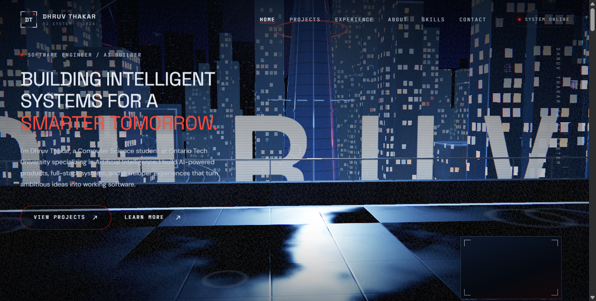
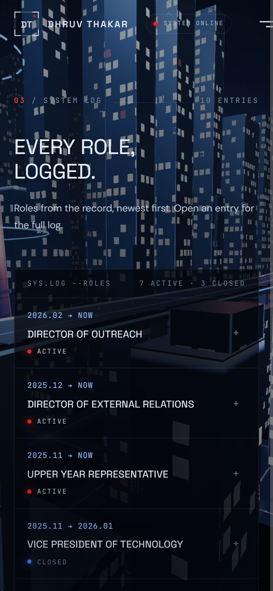
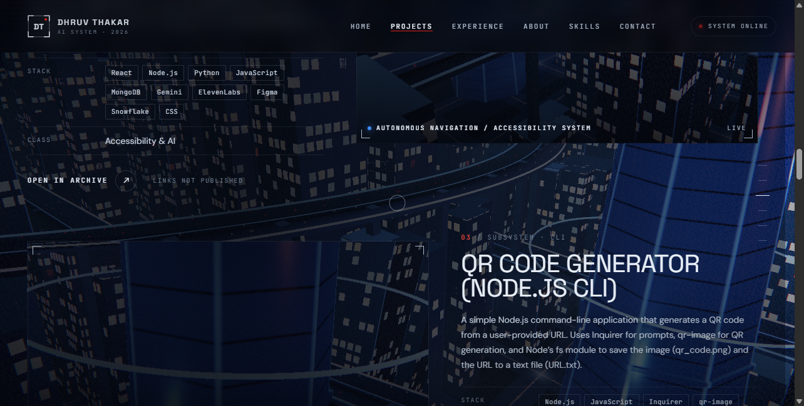
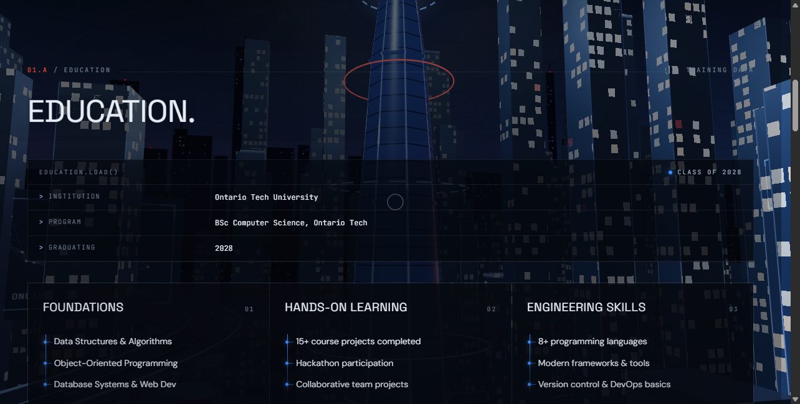
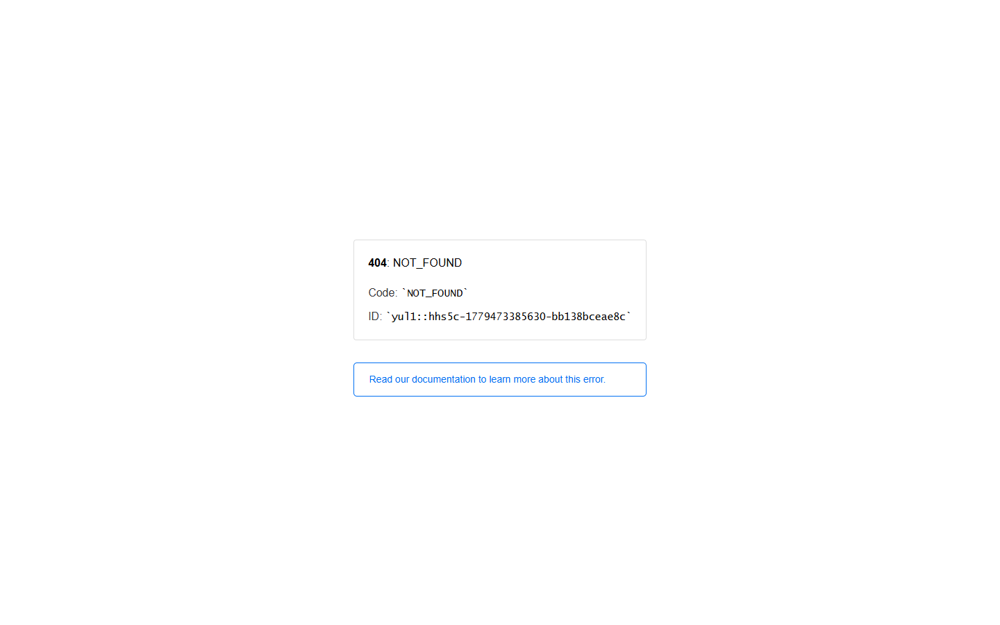
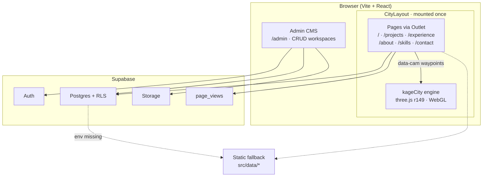

<div align="center">

# Dhruv Thakar — Portfolio & Admin CMS

**A personal portfolio that runs as one live WebGL city, with a Supabase-backed admin CMS behind it.**

[](https://www.thakardhruv.me/)
[](https://github.com/dhruvht612/My_Portfolio)
[](https://github.com/dhruvht612/My_Portfolio/stargazers)
[](https://github.com/dhruvht612/My_Portfolio/forks)
[](https://react.dev/)
[](https://threejs.org/)
[](https://vite.dev/)
[](https://supabase.com/)
[](https://tailwindcss.com/)

**Live site:** [https://www.thakardhruv.me/](https://www.thakardhruv.me/)

</div>

---

## Table of contents

- [Screenshots](#screenshots)
- [Why I built this](#why-i-built-this)
- [Overview](#overview)
- [Live demo & routes](#live-demo--routes)
- [How the city works](#how-the-city-works)
- [Featured projects](#featured-projects)
- [UI & UX](#ui--ux)
- [Tech stack](#tech-stack)
- [Architecture](#architecture)
- [Roadmap](#roadmap)
- [Reusable building blocks](#reusable-building-blocks)
- [Open-source value](#open-source-value)
- [Contributing](#contributing)
- [GitHub profile](#github-profile)
- [Quick start](#quick-start)
- [Environment variables](#environment-variables)
- [Scripts](#scripts)
- [Project structure](#project-structure)
- [Recent commits](#recent-commits)
- [Documentation](#documentation)
- [Deployment](#deployment)
- [Troubleshooting](#troubleshooting)
- [License](#license)

---

## Screenshots

| Home (`/`) | Mobile |
| :---: | :---: |
| [](https://www.thakardhruv.me/) | [](https://www.thakardhruv.me/experience) |

| Projects | About · Education |
| :---: | :---: |
| [](https://www.thakardhruv.me/projects) | [](https://www.thakardhruv.me/about#education) |

| Admin dashboard | Analytics |
| :---: | :---: |
| [](https://www.thakardhruv.me/admin) | [](https://www.thakardhruv.me/admin/analytics) |

*Live at [thakardhruv.me](https://www.thakardhruv.me/). Admin views require sign-in.*

---

## Why I built this

Most portfolio templates felt static and difficult to maintain at scale. I wanted a system where portfolio content could be managed like a lightweight CMS while still feeling modern, animated, and developer-focused.

This project became both my portfolio and an experiment in reusable frontend/admin architecture using React, Supabase, and modular UI systems.

The October 2026 redesign took the public side further: instead of a set of separate pages, the whole site is one night city rendered in WebGL. Every page is a district of it, and moving between pages flies the camera across town.

---

## Overview

This repository is both a **public portfolio** and a **full content-management admin** for the same site. Visitors walk through a live 3D city; you get an auth-protected `/admin` area to edit profile, experience, projects, skills, certifications, blog posts, education, messages, and analytics without redeploying for every copy change.

| Surface | What you get |
| --- | --- |
| **Public site** | One persistent WebGL city under six pages: Home, Projects, Experience, About (with Education, Certifications, Beyond), Skills, Contact |
| **Admin CMS** | CRUD workspaces, multi-step forms, markdown editor, image upload, analytics charts |
| **Data layer** | Supabase-first with static fallback when env vars are missing |

---

## Live demo & routes

**Production:** [https://www.thakardhruv.me/](https://www.thakardhruv.me/)

| Page | Path | Where the camera stands |
| --- | --- | --- |
| **Home** | `/` | The full walk: all six scenes in order |
| **About** | `/about` (sections `#education`, `#certifications`, `#beyond`) | The AI core |
| **Projects** | `/projects` | The project network |
| **Experience** | `/experience` | The highway (system log) |
| **Skills** | `/skills` | The infrastructure |
| **Contact** | `/contact` (form at `#message`) | The highest point |
| **Admin login** | `/admin/login` | — (classic design) |
| **Admin dashboard** | `/admin` | — (classic design) |

Old URLs still work: `/home` → `/`, and `/education`, `/certifications`, `/beyond` → their sections on `/about`.

**Local preview:** `http://localhost:5173` after `npm run dev`.

---

## How the city works

The public site is a single WebGL scene that never reloads between pages.

- **One engine, mounted once.** `CityLayout` (`src/components/futuristic/CityLayout.jsx`) mounts the engine (`engine/kageCity.js`) when you first land, and every public route renders inside it through `<Outlet />`. Navigating swaps the HTML on top; the city underneath stays up.
- **Sections choose the camera.** Each page section carries `data-cam="n"`, a waypoint on one camera path: `0` city overview, `1` AI core, `2` project network, `3` system log, `4` technology, `5` connection. Home has all six, so scrolling walks the path. A subpage has one, so the camera parks at its district, and a route change glides there.
- **Live windows.** Elements marked `data-view` (the hero's core feed, each project's frame) are rendered by the engine with their own cameras and composited into the page at their DOM position.
- **Readable first.** All content is plain semantic HTML from the portfolio data; the 3D layer is decoration and never holds information on its own.
- **Fallbacks.**
  - Without WebGL, or on a software renderer (SwiftShader, llvmpipe), the site serves a static night backdrop with all content revealed, so nothing hangs on machines without a usable GPU.
  - Reduced-motion users get no camera drift and instant cuts between districts.
  - Touch devices default to a lighter quality profile, and an adaptive governor lowers resolution when frames run slow.

Query parameters for reviewing and debugging (read once, on load):

| Param | Effect |
| --- | --- |
| `q=low` / `q=high` | Quality profile (touch devices default to `low`) |
| `post=0` | Skip the bloom / grading post-processing chain |
| `shadow=0` | Disable shadows |
| `dpr=1.2` | Cap the device pixel ratio |
| `adapt=0` | Lock resolution (turn off the adaptive governor) |
| `nogl=1` | Force the no-WebGL fallback |
| `swgl=1` | Keep WebGL even on a software renderer (headless review) |
| `shot=0`–`5` | Jump straight to a scene with everything revealed (screenshots) |

The engine is ported from the ThreeUI **Kage** landing-page engine (MIT). three.js r149 is vendored at `public/kage/three.min.js` and served with an immutable cache header, so **rename the file on any three.js upgrade**.

---

## Featured projects

Work highlighted on the portfolio (also manageable from **Admin → Projects**).

### Trail — Indoor accessibility & sensory-aware navigation

Accessibility-first indoor routing: physical barriers, sensory-heavy zones, calm warnings, and alternate paths. Unified accessibility graph with crowdsourced data and AI-assisted labels.

| | |
| --- | --- |
| **Stack** | React, Node.js, Python, MongoDB, Gemini, ElevenLabs, Figma |
| **Focus** | AODA-aligned experiential inclusion, navigation UX |

### Wisely — Goal-based spending tracker

Goal CRUD, Plaid (sandbox) bank sync, real-time progress from categorized transactions, and a local Ollama assistant for spending insights.

| | |
| --- | --- |
| **Stack** | React, Node.js, Express, SQLite, Prisma, Plaid, Ollama |
| **Focus** | Fintech dashboard, secure data handling |

### Portfolio & admin CMS (this repo)

The site you are reading about: a WebGL city as the public site, a Supabase contact inbox, analytics dashboard, system health probes, and workspace-style admin modules (profile, projects, skills, education, notifications, settings).

| | |
| --- | --- |
| **Stack** | React 19, three.js, Vite 7, Supabase, Tailwind, React Hook Form, Zod, Recharts |
| **Focus** | Real-time 3D on a content site, CMS-in-a-portfolio, reusable admin primitives |

### More builds (on the site)

- **Internix** — AI internship copilot
- **Connectly** — real-time multi-room communication platform
- **Before the Appointment** — health translator (frontend)
- **Farm Flight**
- **Book Catalog System**
- **QR Code Generator** — Node.js CLI with Inquirer and `qr-image`
- **File compression tool** — Huffman coding, Java OOP + data structures

---

## UI & UX

Designed for clarity, motion, and keyboard-friendly use, not a generic template.

- **The city.** Scroll-driven camera through a procedural night megacity: an AI core tower, elevated highways with traffic, flying vehicles, holographic panels, rain, bloom and grading. The 3D wordmark and the live camera windows are part of the same scene.
- **Navigation.**
  - Six-link bar with a burger sheet under 820px, and a scene rail on Home.
  - Route changes glide the camera; in-page links scroll to their scene.
  - Skip link and focus management.
- **Typography & tone.** Space Grotesk, DM Sans and JetBrains Mono, self-hosted; system-log styling (boot readouts, `<details>` logs, module grids).
- **Contact.** A native, labelled form posting to Supabase, with inline validation and a status region.
- **Accessibility.**
  - Semantic landmarks and one `h1` per page.
  - `aria-current` on the active page.
  - Reduced-motion support; all content stays readable without WebGL.
- **Admin UX.** Command palette, keyboard shortcuts overlay, empty states, confirm dialogs, loading skeletons, toast feedback.
- **Responsive.** Lighter rendering profile on touch devices; admin layouts adapt from mobile through desktop sidebars.

---

## Tech stack

| Layer | Technologies |
| --- | --- |
| **UI** | React 19, React Router 7, three.js r149 (WebGL city), Framer Motion (admin), Lucide |
| **Build** | Vite 7, ESLint 9 |
| **Styling** | Scoped city stylesheet (`futuristic.css`), Tailwind CSS 3 for admin |
| **Backend** | Supabase (Postgres, Auth, Storage, RLS) |
| **Forms** | React Hook Form, Zod, `@hookform/resolvers` |
| **Content** | `react-markdown`, `remark-gfm` |
| **Analytics** | Supabase `page_views`, Vercel Web Analytics, Recharts, `date-fns` |
| **Quality** | Vitest + Testing Library, GitHub Actions (lint, test, build, bundle budget), Lighthouse CI, Dependabot |
| **Hosting** | Vercel |

---

## Architecture

High-level data flow for the portfolio + admin CMS.



| Layer | Responsibility |
| --- | --- |
| **City shell** | Mounts the engine once, tells it when the route changes, sets page titles |
| **Public pages** | Plain HTML sections from portfolio data; each names its camera waypoint |
| **Admin SPA** | Auth-gated CRUD, wizards, markdown, uploads, charts |
| **Supabase** | Source of truth for portfolio content, messages, analytics |
| **Fallback** | Local data modules when Supabase is not configured |

---

## Roadmap

Planned improvements (issues and PRs welcome):

| Status | Feature |
| --- | --- |
| 🔲 | **Retire the classic site code**: remove the pre-redesign pages and components still in `src/components/` |
| 🔲 | **City feature parity**: project filters, search and detail view; skill → project links; experience impact details; résumé downloads on About |
| 🔲 | **Back/forward scroll restoration** across city pages |
| 🔲 | **`sitemap.xml` and `robots.txt`**, plus a new `og:image` of the city |
| 🔲 | **Public blog**: `/blog` and `/blog/:slug` on the portfolio site |
| 🔲 | **Real-time admin**: Supabase subscriptions for live list updates |
| 🔲 | **SEO per post**: Open Graph tags, descriptions, `og:image` from storage |
| 🔲 | **Scheduled publishing**: future `published_at` for blog/content |
| 🔲 | **Admin audit log**: who changed what and when |
| 🔲 | **Role-based access**: limited admin roles for collaborators |
| 🔲 | **Advanced analytics**: geography, sessions, bounce rate, export CSV/PDF |
| 🔲 | **Image transforms**: Supabase Image Transformation for uploads |
| 🔲 | **Contact webhooks**: Edge Function sync for notifications |

---

## Reusable building blocks

Fork or copy these patterns into other React projects.

### The city (`src/components/futuristic/`)

| Module | Use case |
| --- | --- |
| `engine/kageCity.js` | `mountKageCity(root)` → `{ refresh, setPage, dispose }`: a WebGL scene driven by the page's own `[data-cam]` sections, with full GPU cleanup on dispose |
| `CityLayout` | Persistent route shell: one engine across routes, per-page titles, page views |
| `FuturisticNavigation` / `FuturisticHUD` | Router-aware nav bar; canvas host, preloader, scene rail, cursor |
| `FuturisticHero` … `FuturisticContact` | Section components: one scene each, data from `usePortfolio()` |
| `FuturisticAboutExtras` | Education, certifications and beyond, as system-log sections |
| `FuturisticContactForm` | Native form → Supabase `contact_submissions` |
| `portfolioSystems.js` | Pure mappers from portfolio data to the city's "systems" (tested) |

### Admin primitives (`src/components/admin/`)

| Component / hook | Use case |
| --- | --- |
| `AdminForm` / `AdminFormWizard` | Zod-validated forms with multi-step flow |
| `DataTable` | Sortable lists with actions |
| `MarkdownEditor` | Rich text for blog/content |
| `ImageUploader` | Supabase Storage uploads |
| `TagInput` / `ArrayInput` | Dynamic list fields |
| `ConfirmDialog` / `EmptyState` | Safe deletes and zero-data UX |
| `AnalyticsChart` | Dashboard visualizations |
| `useAdminCrud` | Generic table list + insert/update/delete |

### UI kit (`src/components/ui/`)

| Component | Use case |
| --- | --- |
| `button` / `input` / `badge` | Base controls |
| `glowing-shadow` / `holographic-card` | Card emphasis |
| `particles-bg` | Background effects (admin login and 404) |
| `modern-animated-sign-in` | Auth screen polish |
| `interactive-logs-table-shadcnui` | Dense data tables |

Schemas in `src/schemas/` mirror admin forms and can be reused for API validation.

---

## Open-source value

Use this repo as a **starter for portfolio + CMS**, not only a résumé site.

- **Supabase-first CMS**: edit content in production without touching JSON files.
- **Graceful degradation**:
  - Public pages still render from `src/data/` when Supabase is not configured.
  - The city falls back to static HTML without a usable GPU.
- **A mountable WebGL engine**: a scroll-driven three.js scene that reads its camera path from the DOM, survives route changes, and cleans up after itself.
- **Documented backend plan**: see `docs/backend-integration-plan.md` for tables, RLS, and migrations.
- **Seed & verify scripts**: `npm run seed` and `npm run verify:phase5` for reproducible setup.
- **Vercel-ready build**: the production build fails fast if Supabase env is missing on Vercel (see `vite.config.js`).

**Good fits for forking:** developer portfolios, student project hubs, small team "about + work" sites with an internal admin.

---

## Contributing

Suggestions, issues, and forks are welcome. If you build on top of this project, feel free to open a PR or share your version.

1. Fork the repo and create a branch (`git checkout -b feature/your-idea`).
2. Make your changes, then run `npm run lint:ci` and `npm run test:run`.
3. Open a pull request with a short description of what you changed. CI runs lint, tests, the build and the bundle budget, and Lighthouse audits `/` and `/contact`.

---

## GitHub profile

If this repo represents your work, **pin it on your GitHub profile** so visitors see it first:

**Settings → Profile → Pin repositories**

Suggested pins:

- **Portfolio CMS** (this repo)
- **Trail**
- **Wisely**
- **Connectly** (if public)

Your profile presentation matters almost as much as the repo itself.

---

## Quick start

### Prerequisites

- **Node.js** 22 (see `.nvmrc`)
- **npm**
- (Optional) **Supabase** project for live CMS and contact inbox
- A browser with WebGL and a GPU to see the city (everything else works without one)

### Install and run

```bash
git clone https://github.com/dhruvht612/My_Portfolio.git
cd My_Portfolio
npm install
npm run dev
```

Open **http://localhost:5173**.

### Production build

```bash
npm run build
npm run preview   # local check of dist/
```

### Optional: seed Supabase

```bash
# .env.local must include VITE_SUPABASE_URL + SUPABASE_SERVICE_ROLE_KEY
npm run seed
npm run verify:phase5
```

---

## Environment variables

Copy `.env.example` to `.env.local`:

```bash
VITE_SUPABASE_URL=https://your-project-id.supabase.co
VITE_SUPABASE_ANON_KEY=your-anon-public-key
SUPABASE_SERVICE_ROLE_KEY=your-service-role-key   # scripts only — never expose to client
```

| Variable | Scope | Purpose |
| --- | --- | --- |
| `VITE_SUPABASE_URL` | Client | Supabase project URL |
| `VITE_SUPABASE_ANON_KEY` | Client | Public anon key (`VITE_SUPABASE_PUBLISHABLE_KEY` also accepted) |
| `SUPABASE_SERVICE_ROLE_KEY` | Node scripts | Seed / migrate / verify |
| `VITE_HEALTH_CHECK_ORIGIN` | Client | Admin system-health frontend probe |
| `VITE_API_URL` | Client | Optional API health card |

- `VITE_*` values are embedded in the client bundle.
- Never commit real service-role keys.
- Without the Supabase values the site still runs on static data, but the contact form shows as offline.

---

## Scripts

| Command | Purpose |
| --- | --- |
| `npm run dev` | Vite dev server |
| `npm run build` | Production build → `dist/` |
| `npm run preview` | Preview production build |
| `npm run lint` | ESLint |
| `npm run lint:ci` | ESLint with CI's warning cap |
| `npm test` | Vitest in watch mode |
| `npm run test:run` | Vitest, single run |
| `npm run test:coverage` | Vitest with coverage |
| `npm run size` | Gzip bundle budget check (`--update` to re-seed `bundle-budget.json`) |
| `npm run seed` | Seed Supabase from local portfolio data |
| `npm run migrate-assets` | Asset upload / migration workflow |
| `npm run verify:phase5` | Verify Supabase phase-5 setup |

---

## Project structure

```text
.
├── src/
│   ├── components/
│   │   ├── futuristic/     # The city: CityLayout, sections, styles
│   │   │   └── engine/     # kageCity.js, the WebGL engine
│   │   ├── admin/          # Admin primitives
│   │   └── ui/             # UI kit
│   ├── pages/              # Route pages (public + /admin)
│   ├── hooks/              # Auth, CRUD, analytics, Supabase
│   ├── context/            # Portfolio data provider
│   ├── lib/                # Supabase client and adapters
│   ├── schemas/            # Zod schemas for admin forms
│   ├── scripts/            # Seed, migrate, verify
│   ├── constants/          # Routes, nav, UI tokens
│   └── data/               # Static fallback content
├── public/
│   ├── kage/               # Vendored three.js r149
│   └── fonts/              # Self-hosted DM Sans, Space Grotesk, JetBrains Mono
├── scripts/                # Bundle budget check
├── .github/workflows/      # CI, Lighthouse, npm audit
├── docs/
│   └── screenshots/        # README screenshots
└── package.json
```

---

## Recent commits

| Commit | Summary | Date |
| --- | --- | --- |
| `8be572a` | Merge #28: the city redesign goes live | 2026-10-13 |
| `10bc824` | Serve the no-WebGL city on software-rendered WebGL | 2026-10-13 |
| `a237f87` | Multi-page site on one persistent city | 2026-10-13 |
| `e0cf9de` | City redesign, single-page baseline | 2026-10-13 |
| `e5ae5d7` | 3D design standalone HTML prototype | 2026-09-25 |
| `899dee1` | Merge #21: CI/CD pipeline | 2026-09-23 |
| `a64ea48` | Production dependency updates | 2026-09-21 |
| `66cb8ac` | AGENTS and FEATURES documentation | 2026-09-10 |

Full history: [`git log`](https://github.com/dhruvht612/My_Portfolio/commits/main)

---

## Documentation

| Doc | Topic |
| --- | --- |
| [`docs/overview.md`](docs/overview.md) | Public sections and data flow |
| [`docs/content-management.md`](docs/content-management.md) | CMS workflows |
| [`docs/backend-integration-plan.md`](docs/backend-integration-plan.md) | Supabase schema and RLS |
| [`docs/deployment.md`](docs/deployment.md) | Hosting (Vercel, Netlify, GitHub Pages) |
| [`docs/ci-cd.md`](docs/ci-cd.md) | CI pipeline, required checks, bundle budget |
| [`docs/phase5-runbook.md`](docs/phase5-runbook.md) | Phase-5 verification runbook |

---

## Deployment

The site deploys to **Vercel** from `main`; `vercel.json` already holds the SPA rewrite and cache headers.

1. Add `VITE_SUPABASE_URL` and `VITE_SUPABASE_ANON_KEY` to the Vercel project for **both Production and Preview**. The build fails on purpose without them.
2. Open a PR: CI must pass **Lint, test, build**; Lighthouse and the Vercel preview run alongside.
3. Merge to `main` to deploy. To undo a bad release, use **Instant Rollback** in Vercel, then revert the merge on `main` so the code matches what's live.
4. Configure Supabase RLS policies, storage buckets, and run `npm run seed` if needed.

Details: [`docs/deployment.md`](docs/deployment.md) · [`docs/ci-cd.md`](docs/ci-cd.md)

---

## Troubleshooting

| Issue | Check |
| --- | --- |
| City shows a flat night backdrop, no 3D | WebGL is unavailable or software-rendered (see `chrome://gpu`); this is the intended fallback. `?swgl=1` forces WebGL anyway |
| City looks soft or low-resolution | The adaptive governor lowered resolution because frames were slow (DevTools open counts); `?adapt=0` locks it |
| 404 on refresh in production | SPA fallback / rewrite rules |
| Admin login fails | Supabase URL, anon key, and auth users |
| Empty admin or public data | RLS policies, seed script, table names |
| Contact form says it's offline | Supabase env vars missing in this environment |
| Contact inbox empty | `contact_submissions` insert policy |
| Vercel build fails on Supabase | Env vars on Production **and** Preview + redeploy |
| Stale styles or modules | `rm -rf node_modules && npm install` |

---

## License

[MIT](LICENSE): use, fork, and adapt with attribution.

Third-party: the city engine is ported from the ThreeUI "Kage" landing page (MIT License, Copyright (c) 2026 Meng To); three.js is MIT-licensed by its authors.

---

<div align="center">

**Built by [Dhruv Thakar](https://www.thakardhruv.me/)** · [GitHub](https://github.com/dhruvht612) · [LinkedIn](https://linkedin.com/in/dhruv-thakar-ba46aa296)

</div>
